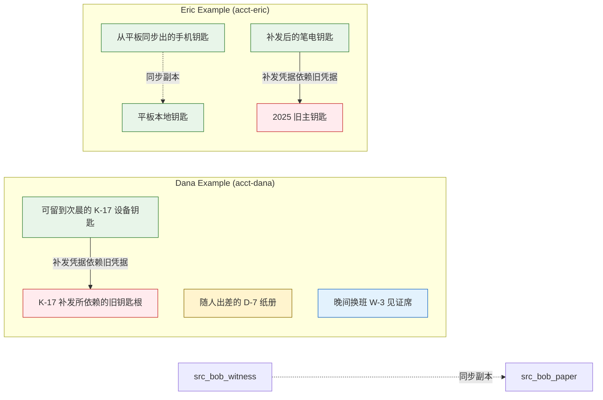

# 本地账号恢复柜台

结论先说：**会。两份看起来不同的确认，可能通过“补发时依赖的旧凭据”或“同步关系”追到同一把旧钥匙/同一个同步根。** 本柜台不按确认数量判断，而按来源血缘的闭包判断：两份确认的根集合/血缘闭包只要相交，就不算两个独立来源。

纯 Python 标准库 + SQLite。所有申请、接管单、来源关系、拒绝记录和设置修订都在本地数据库里；进程重启后仍可复查。

## 30 秒运行

```bash
./desk demo                 # 重建 data/desk.db 并跑完所有桌面演练
./desk verify               # 检查接管单证据数、销毁记录、设置修订一致性
./desk status               # 查看虚构账号、接管单、旧机草稿
./desk history --all-branches
./desk replays
python3 -m unittest discover -s tests -v
```

演示结束后：

- `data/desk.db`：主柜台，保存 5 个虚构账号和主时间线真实提交的设置。
- `data/snapshots/dana-base.db`：Dana 同一笔已办成接管的分叉快照。
- `data/replay/dana-paper-loss.db`：重放“纸册先报失”的分支。
- `data/replay/dana-witness-correction.db`：重放“见证记录先更正”的分支。

这些都是普通 SQLite 文件，重启后可用 `./desk ...` 或 `sqlite3` 复查。

## 判定规则

1. 登记设备、纸质恢复册、见证席、设备钥匙等来源。
2. 补发凭据时用 `credential_dependencies` 明确记录它依赖哪些旧凭据。
3. 来源血缘包括：
   - 显式同步/依赖边；
   - 凭据补发依赖边传递到的旧凭据来源；
   - 相同的 `root_id` 同步根。
4. 两份确认只有同时满足以下条件，程序才会开接管单：
   - 确认材料仍保留；
   - 来源状态为 `valid` 且未过 `valid_until`；
   - 两个血缘闭包不相交、根不同。
5. 接管单的 `order_evidence` **恰好两行**，只固化本次选中的两份证据、根、血缘和指纹。
6. 同一轮未选中的第三份确认会被销毁陈述和签名（`retained=0`，`statement/signature/signer/device_id=NULL`），只保留用于接收撤销通知的来源 ID。它不能回填旧单。
7. 开单后，新机还要：
   - `order-claim`：领单；
   - `order-sign`：签收接管确认；
   - 然后才能 `setting-change`。
8. 旧设备上只开始、未确认的设置变更保持 `pending`；接管不会携带或落地该草稿。

## 虚构账号与对应演练

| 账号 | 场景 | 结果 |
|---|---|---|
| `acct-alice` | 纸册 + 见证席两条独立来源 | 接管成功，`auto_lock_minutes: 30 -> 5` |
| `acct-bob` | 先让纸册/见证席独立办成；再把见证来源改成纸册的同步副本 | 第一笔成功并留下真实修订；血缘变更后 `ord-bob-1` 被重新校验为 `paused`，第二笔申请报 `NO_INDEPENDENT_PAIR`，不生成 `ord-bob-2` |
| `acct-carol` | 接管单已开、新机已领单但未签收；旧机有未确认草稿 | 旧机搭车、旧机直接提交、旧机代签收、新机未签收改设置全部被拒；新机签收后才能改设置；旧草稿仍 `pending` |
| `acct-eric` | 平板和由它同步的手机各签一次；另有补发凭据追到旧主钥匙 | 两次签名存在，但共享同步根/旧钥匙血缘，不能凑成两份独立证明 |
| `acct-dana` | 三条合格证明与两种明早前后续 | 程序选“纸册 + 设备钥匙”；从同一已完成快照重放两种撤销 |

## 来源关系图

关键关系如下；完整输出保存在 `docs/source-graph.mmd`，也可用 `./desk graph --format mermaid` 重新生成。实线表示补发凭据对旧凭据的信任依赖，虚线表示同步副本；Bob 的边是演练中“把一条来源改成另一条同步副本”后产生的。



也可随时生成最新图：

```bash
./desk graph --format mermaid
./desk graph --account acct-dana --format ascii
```

## Dana：同一笔已办成接管的两种重放

初始三条合格来源：

- `src-dana-paper`：随人出差的纸册；
- `src-dana-witness`：晚间换班见证席；
- `src-dana-key`：可留到次晨 09:00 的设备钥匙；该钥匙凭据补发时依赖 `src-dana-oldkey`。

程序的选择策略是：

1. 过滤当前有效、未过期的确认；
2. 枚举血缘/根互不相交的两份组合；
3. 按风险分和稳定 ID 排序；
4. 本轮选择 **设备钥匙 + 纸册**（数据库中顺序为 `src-dana-key,src-dana-paper`），不选见证席；
5. 当前两份已足够，因此决定 **暂不额外当面换证**。

同一笔 `ord-dana` 已在 20:20 签收，并在 20:25 把设置从 `30` 改成 `10`。随后从同一个 `dana-base.db` 分叉出两个未来：

| 重放分支 | 撤销的来源 | 是否在冻结的两份证据中 | 原接管单/新机能否办事 | 截止前处理 |
|---|---|---:|---|---|
| `paper-loss` | 纸册 | 是 | **必须暂停**；再改 `10 -> 5` 被 `EVIDENCE_REVOKED` 拒绝，订单变 `paused` | 不能用已丢弃的 `cnf-dana-witness` 补签昨天的单；07:15 程序判断本人到场可立新单，07:20 建立新的当面信任根和 `ord-dana-remedy`，07:45 成功改成 `5` |
| `witness-correction` | 当班见证来源 | 否；它正是未选用且材料已销毁的第三来源 | **仍可办事**；纸册+钥匙仍有效且独立，01:15 成功改成 `5` | 不需要当面换证 |

两个分支都尝试把旧见证确认回填到 `ord-dana`，结果都是：

```text
THIRD_PROOF_DISCARDED: 第三份证明材料已丢弃，不能补签或回填昨天已冻结的接管单
```

注意：纸册报失分支里，见证来源在该替代未来中并没有被更正、仍然有效；但因为它的证明材料在开单时已按规则销毁，仍然不能拿来补签昨天的单。合法路径只能是本人重新到场、建立新来源/新申请/新接管单。

持久化的重放结论：

```bash
./desk replays
```

数据库本身也是普通 SQLite 文件；若机器上装有 `sqlite3`，也可直接查询 `replay_runs` 表。

## 重启后复查“哪次设置真的改过”

只有成功提交才会写 `setting_revisions` 并更新当前 `settings`。被拒绝的尝试只进 `audit_events`，不会产生修订。

```bash
./desk history --all-branches
```

主库当前真实修订：

```text
#1 acct-alice 30 -> 5  order=ord-alice-1
#2 acct-bob   30 -> 5  order=ord-bob-1
#3 acct-carol 30 -> 7  order=ord-carol
#4 acct-dana  30 -> 10 order=ord-dana
```

分支库中额外的真实修订：

```text
witness-correction: ord-dana         10 -> 5 at 2026-11-27T01:15
paper-loss:         ord-dana-remedy  10 -> 5 at 2026-11-27T07:45
```

纸册报失分支中对原 `ord-dana` 的 `10 -> 5` 请求没有修订；该订单状态为 `paused`。

## 手工命令流

可以在临时库中手工提交一笔申请：

```bash
DB=/tmp/recovery-counter.db

./desk init --db "$DB"
./desk account-add acct-t Taro --db "$DB"
./desk device-add dev-old acct-t old-phone --role old --db "$DB"
./desk device-add dev-new acct-t new-phone --role new --db "$DB"

./desk source-add src-p acct-t paper_booklet "P-1 paper booklet" --db "$DB"
./desk source-add src-w acct-t witness_desk "W-1 witness" --db "$DB"
./desk credential-add c-p acct-t src-p paper-code --db "$DB"
./desk credential-add c-w acct-t src-w witness-code --db "$DB"

./desk application-submit app-t acct-t --old dev-old --new dev-new \
  --deadline 2026-11-27T08:00:00 --db "$DB"
./desk confirm c1 acct-t src-p --app app-t --credential c-p --db "$DB"
./desk confirm c2 acct-t src-w --app app-t --credential c-w --db "$DB"

./desk order-issue app-t ord-t --db "$DB"
./desk order-claim ord-t dev-new --db "$DB"

# 尚未 order-sign，下面会报 ORDER_NOT_EFFECTIVE：
./desk setting-change acct-t dev-new 9 --order ord-t --db "$DB" || true

./desk order-sign ord-t dev-new --db "$DB"
./desk setting-change acct-t dev-new 9 --order ord-t --db "$DB"
./desk history --db "$DB"
```

补发依赖和同步副本：

```bash
./desk credential-reissue c-key-2 acct-dana src-dana-key night-key \
  --parent cred-dana-oldkey --db data/desk.db

./desk source-link-sync src-bob-witness src-bob-paper \
  --note "演练：改成同步副本"
```

撤销来源与程序换证判断：

```bash
./desk source-revoke src-dana-paper "paper booklet lost" \
  --at 2026-11-26T23:05:00

./desk remedy-decide ord-dana \
  --at 2026-11-27T07:15:00
```

## 代码地图

- `recovery_desk.py`：SQLite schema、血缘/独立性判断、申请/接管单/设置状态机、CLI。
- `scenarios.py`：五个虚构账号、Dana 双未来快照重放。
- `tests/test_desk.py`：独立性、同步副本、第三证明销毁、未签收/旧草稿、双分支重放和重启持久化测试。
- `docs/source-graph.mmd`：生成的 Mermaid 来源图。
